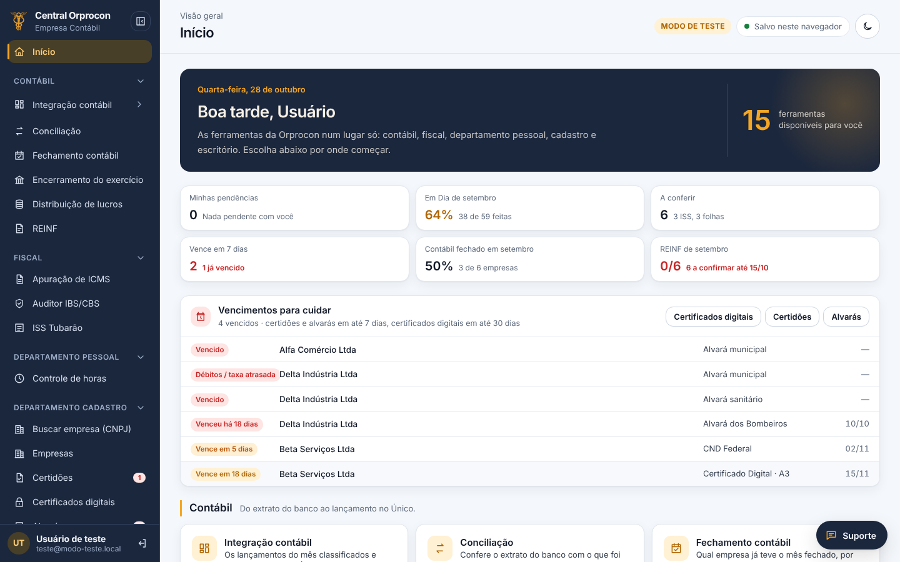
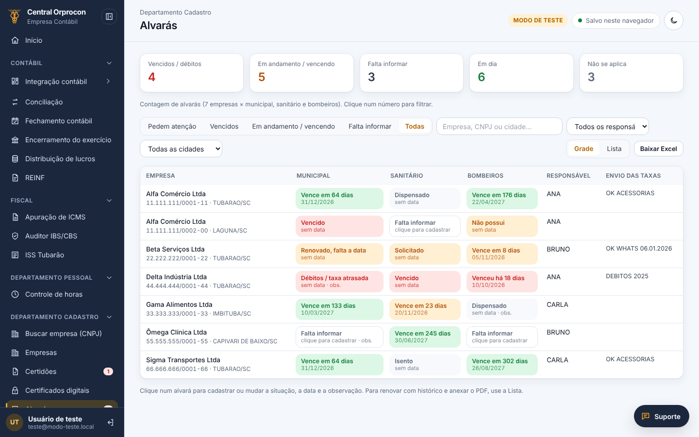
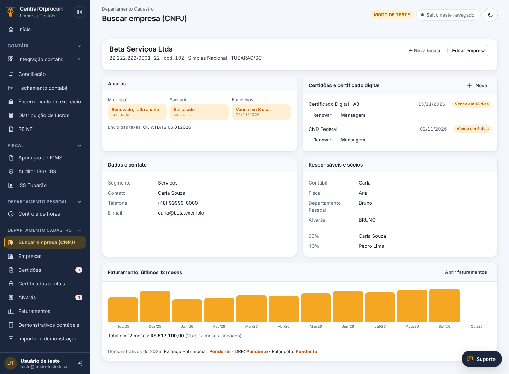
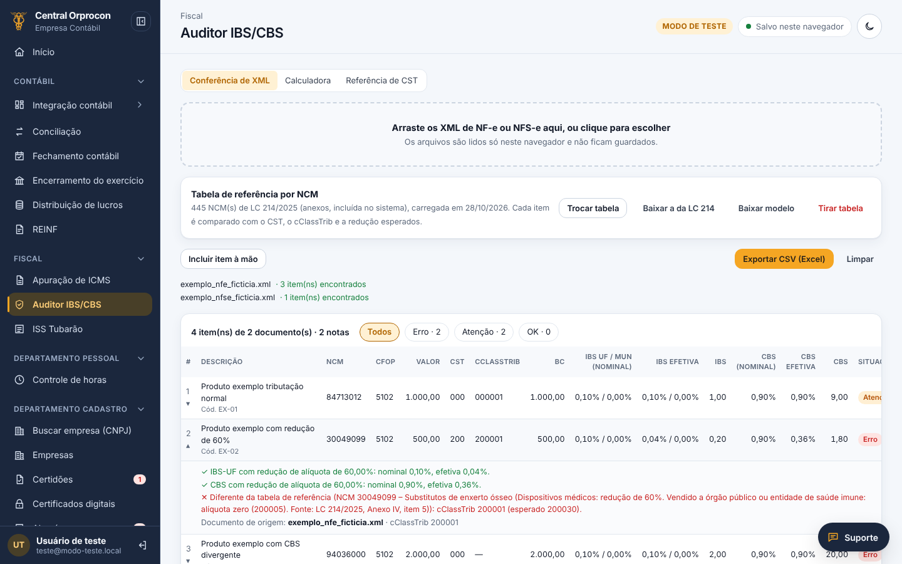
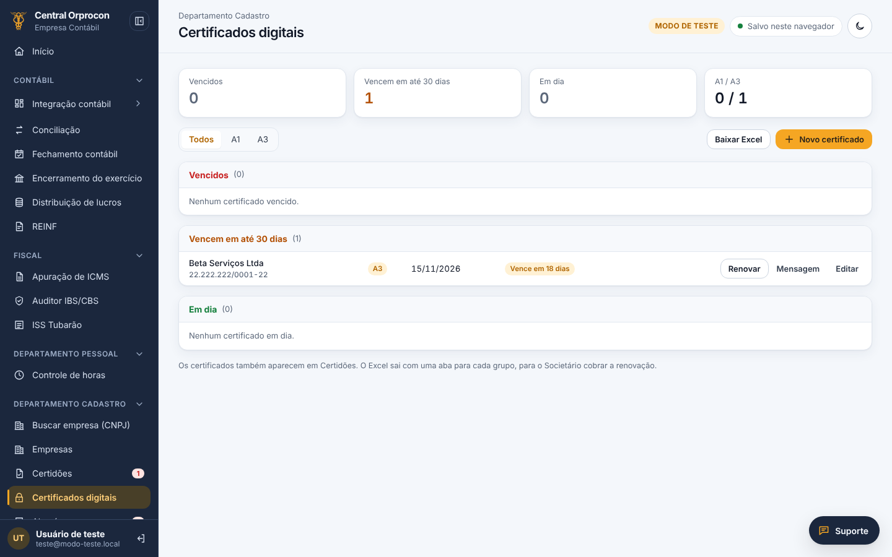
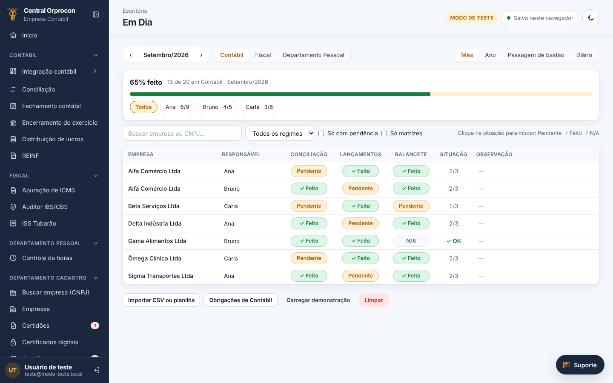
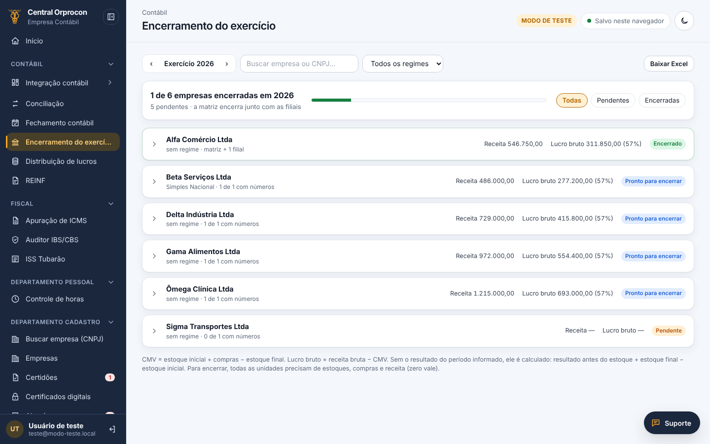
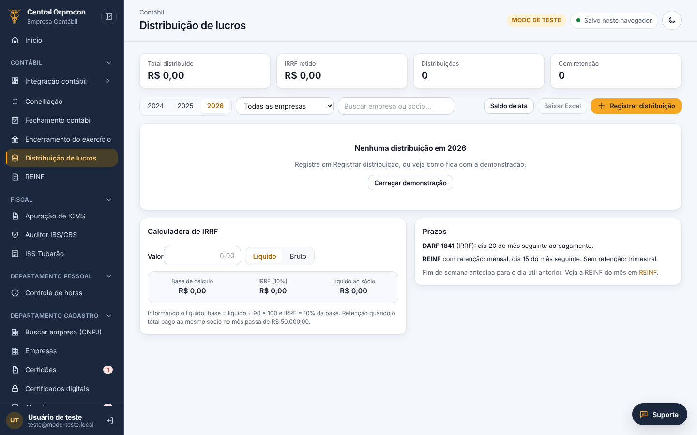
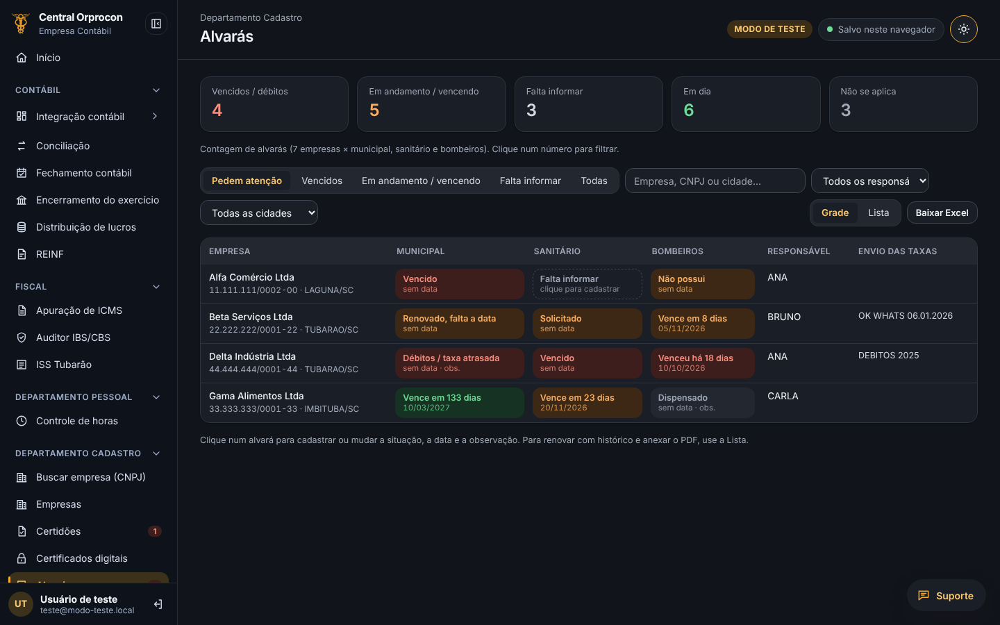
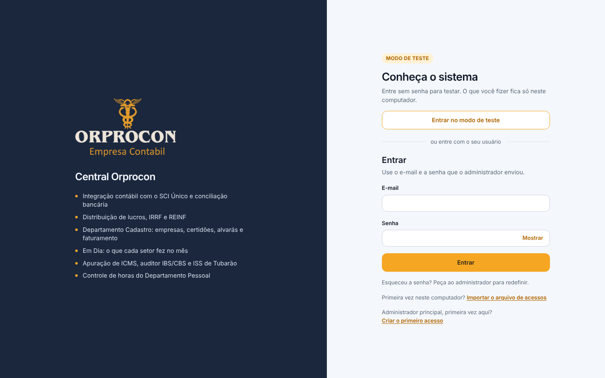

# 🏢 Central Orprocon • Plataforma de Gestão para Escritório de Contabilidade

[](https://react.dev)
[](https://vitejs.dev)
[](https://tailwindcss.com)
[](#-app-instalável-pwa)
[-339933?logo=nodedotjs&logoColor=white)](#-testes-e-qualidade)
[](https://github.com/orprocondigital-web/Orprocon-Gestao-Financeira-React/actions/workflows/publicar.yml)
[](#-versões)

**Sistema web em produção que reúne as rotinas de um escritório de contabilidade: integração contábil com o ERP, conciliação bancária, tributos (ICMS, ISS, IBS/CBS), vencimentos de certidões, alvarás e certificados, encerramento do exercício e acompanhamento das entregas por setor.**

### 🔗 [Abrir a Central](https://orprocondigital-web.github.io/Orprocon-Gestao-Financeira-React/) · tem **modo de teste** com dados fictícios, sem precisar de senha

---

## 📖 Sobre o projeto

A Central Orprocon nasceu para tirar o escritório das planilhas soltas e do retrabalho: cada setor (Contábil, Fiscal, Departamento Pessoal, Cadastro e Escritório) encontra num lugar só as ferramentas do dia a dia, e a tela **Início** mostra o que precisa de ação hoje.

Esta é a versão em **React + Tailwind**, que substitui a versão anterior em HTML/JS **sem parar a operação**: as regras de negócio foram trazidas com os testes, módulo a módulo, e os dados que já existiam continuam valendo (mesmas chaves de armazenamento, mesmos usuários). Funciona como **PWA**: instala na área de trabalho e abre sem internet.

| | |
|---|---|
| 👥 **Quem usa** | Equipe do escritório (contábil, fiscal, DP, societário/cadastro) |
| 🧩 **Módulos** | 15 ferramentas em 5 setores, com acesso por área |
| ✅ **Qualidade** | 360+ testes automatizados rodando a cada Pull Request |
| 🚀 **Entrega** | Deploy automático no GitHub Pages a cada merge na `main` |

---

## 🖼️ Telas

> Prints do **modo de teste**, com empresas e dados fictícios.

<p align="center">
  
  <br><sub><b>Início:</b> o resumo do dia e a lista do que vence, com link direto para resolver</sub>
</p>

| | |
|:---:|:---:|
| <br><sub><b>Alvarás em grade</b> com situação e cores</sub> | <br><sub><b>Ficha da empresa</b> pela busca por CNPJ</sub> |
| <br><sub><b>Auditor IBS/CBS</b> com a tabela da LC 214</sub> | <br><sub><b>Certificados digitais</b> A1/A3 por vencimento</sub> |
| <br><sub><b>Em Dia:</b> entregas por setor e responsável</sub> | <br><sub><b>Encerramento do exercício</b> por empresa</sub> |
| <br><sub><b>Distribuição de lucros</b> com IRRF e REINF</sub> | <br><sub><b>Tema escuro</b></sub> |

<details>
<summary>Tela de entrada</summary>
<br>

</details>

---

## ⚡ Funcionalidades

### 1. 🔄 Integração contábil (`/integracao`)
- Importa **extratos bancários** em OFX, PDF (Itaú, Santander, Sicoob, Sicredi, Caixa, BB, Nubank, Inter, C6, Unicred, Banrisul…) e Excel.
- Classifica os lançamentos por regras e gera o **arquivo de importação para o ERP** (SCI Único), por conta e unidade.
- Cadastros de contas bancárias, unidades, fornecedores e outras movimentações; backup em arquivo.

### 2. ⚖️ Conciliação bancária (`/conciliacao`)
- Confere o **extrato × a planilha de lançamentos** por data e valor: o que bateu, o que está só no extrato e o que está só na planilha.

### 3. 🧾 Fiscal: ICMS, ISS e Auditor IBS/CBS (`/icms`, `/iss`, `/ibs-cbs`)
- **Apuração de ICMS** com regras e ajustes por empresa.
- **ISS** do município, com importação do XML do portal.
- **Auditor IBS/CBS (Reforma Tributária):** lê o XML da NF-e/NFS-e e confere base, alíquotas, redução, **CST e cClassTrib** de cada item.
- **Tabela de referência da LC 214/2025 incluída:** 445 NCMs dos anexos de mercadorias, já com as alterações da LC 227/2026, comparados automaticamente com cada item.

### 4. 🗂️ Departamento Cadastro (`/departamento-cadastro/...`)
- **Busca por CNPJ** (inteiro ou parte) e **ficha da empresa**: dados, matriz e filiais, alvarás, certidões, certificado digital, responsáveis, sócios e faturamento de 12 meses numa tela só.
- **Alvarás em grade** (Municipal, Sanitário e Bombeiros) com situação e cores: em dia, vencendo, vencido, não se aplica e falta informar.
- **Certidões** e **certificados digitais (A1/A3)** com vencimento, renovação com histórico, PDF anexado e leitura automática do PDF.
- **Importação pelo CNPJ** da planilha de renovação de alvarás e de listas de empresas, com prévia antes de gravar e sem duplicar.
- **Mensagem pronta** para cobrar a renovação do cliente por e-mail ou WhatsApp.
- Faturamentos mensais e demonstrativos contábeis por empresa.

### 5. 📊 Contábil: fechamento, encerramento, lucros e REINF (`/fechamento`, `/encerramento`, `/lucros`, `/reinf`)
- **Fechamento contábil** do mês por empresa e por responsável.
- **Encerramento do exercício:** estoques, compras, CMV, lucro bruto e resultado por unidade, matriz + filiais + consolidado.
- **Rateio por faturamento** entre os sócios, com IRRF sugerido.
- **Distribuição de lucros** com IRRF de 10% acima de R$ 50 mil no mês, saldo de ata, prazo do DARF e **REINF** por competência.

### 6. 📅 Em Dia e Controle de horas (`/em-dia`, `/horas`)
- **Em Dia:** grade empresas × obrigações por setor e mês, responsáveis com histórico, passagem de bastão e visão do ano por pessoa.
- **Controle de horas** do Departamento Pessoal.

### 7. 🏠 Início, acesso e experiência
- **Vencimentos para cuidar:** o que venceu ou vence na semana, com link direto para resolver.
- **Login por perfil e área**, administração de usuários, senha provisória e **modo de teste** para apresentações.
- Tema **claro e escuro**, menu recolhível, layout para celular e botão de suporte.

---

## 🛠️ Stack tecnológica

| Camada | Tecnologia | Para quê |
|---|---|---|
| Interface | **React 18** + React Router 6 (HashRouter) | Telas e navegação, compatível com GitHub Pages |
| Estilo | **Tailwind CSS 3** + design tokens em CSS | Identidade visual, tema claro/escuro |
| Build | **Vite 5** | Desenvolvimento e build de produção |
| Estado | Serviços em ES Modules + `useSyncExternalStore` | Regras de negócio puras, testáveis e separadas da tela |
| Arquivos | SheetJS, ExcelJS, PDF.js, JSZip (sob demanda) | Ler e gerar Excel, ler PDF e OFX, `.zip` |
| Offline | Service Worker próprio (`pwa/`) | App instalável e funcionamento sem internet |
| Testes | **node:test** (Node 22) | 360+ testes das regras de negócio |
| CI/CD | **GitHub Actions** + GitHub Pages | Testes em todo PR e deploy automático da `main` |
| Backend (em construção) | **Java + Spring Boot + PostgreSQL** | Dados compartilhados entre a equipe |

---

## 🧱 Arquitetura

```
Tela (src/paginas, src/componentes)
        │  usa hooks: useDepCadastro, useLucros, useEmDia…
        ▼
Serviços (src/lib/*.mjs) ── regras de negócio puras, sem React ── testadas em tests/
        │
        ▼
Armazenamento: localStorage / IndexedDB do navegador  →  (próximo passo) API Spring Boot + PostgreSQL
```

- **Regras separadas da tela:** cada módulo tem um serviço em `src/lib/` (ex.: `depCadastro.mjs`, `lucros.mjs`, `ibsCbs.mjs`), criado por uma função que recebe o armazenamento. Assim as regras rodam no navegador e nos testes do Node.
- **Migração sem ruptura:** as regras da versão anterior ficam em `src/legado/` e foram trazidas sem reescrever, com os mesmos testes.
- **Bibliotecas pesadas sob demanda:** leitores de Excel, PDF e a tabela da LC 214 só são carregados quando usados.

---

## 🌿 Branches e governança (Git Flow)

```
main        ●────────●──────────●────────▶  produção (deploy automático)
             \      ↗ \        ↗
develop       ●───●    ●──●──●             homologação
               \ ↗       \ ↗
feat/*          ●         ●                uma mudança por vez
```

- **`main`**: o que o escritório usa. Todo merge publica no GitHub Pages.
- **`develop`**: homologação, onde se testa antes de ir para produção.
- **`feat/nome-curto`**, **`fix/nome-curto`**, **`docs/nome-curto`**: uma mudança por branch, sempre por Pull Request.
- Os **testes rodam em todo PR**; só entra com tudo verde. Versões marcadas com tags (`v1.0.0-alpha.N`).

Passo a passo completo em [`docs/GIT.md`](docs/GIT.md).

---

## 🚀 Como rodar localmente

### Pré-requisitos
- **Node.js 20+** (o CI usa o 22)
- npm

### Passo a passo
```bash
git clone https://github.com/orprocondigital-web/Orprocon-Gestao-Financeira-React.git
cd Orprocon-Gestao-Financeira-React
npm install
npm run dev        # abre em http://localhost:5173
```

### Build, testes e preview
```bash
npm test           # testes das regras (node --test)
npm run build      # gera a pasta dist/ (o que vai para o ar)
npm run preview    # serve o build localmente
```

> Para testar com a API rodando no computador, abra uma vez `http://localhost:5173/?api=http://localhost:8080` e acrescente `http://localhost:5173` em `CORS_ORIGENS` da API.

---

## ✅ Testes e qualidade

- **360+ testes** em `tests/`, cobrindo as regras de cada módulo: leitura de extratos e PDFs, conciliação, ICMS, ISS, IBS/CBS e a tabela da LC 214, vencimentos, importação pelo CNPJ, encerramento, rateio, distribuição de lucros e REINF, Em Dia, login e PWA.
- Os testes usam **dados fictícios**; nenhum dado de cliente fica no repositório.
- O **GitHub Actions** roda os testes e o build em todo Pull Request e publica quando a `main` muda.

---

## 📱 App instalável (PWA)

No Chrome/Edge aparece o botão de instalar (ícone de seta no rodapé do menu). Instalado, o sistema abre pelo ícone na área de trabalho e funciona sem internet.

O `dist/sw.js` é gerado a cada build por `pwa/plugin.mjs`, com uma versão que muda sozinha quando qualquer arquivo muda. Quem está com o sistema aberto vê **"Nova versão disponível · Atualizar"**.

<details>
<summary>Computador preso numa versão antiga?</summary>

F12 → *Application* → *Service workers* → **Unregister**, e *Cache storage* → apagar os `gf-react-*`.
Não use "Clear site data": isso apaga também os dados e os acessos.
</details>

---

## 🔐 Dados e segurança

- Enquanto o backend não está no ar, os dados ficam **no navegador de quem usa** (localStorage e IndexedDB), com backup em arquivo pela Integração contábil.
- **Nada de dado de cliente, senha ou chave no repositório.** Senhas e acessos do banco ficam só em variáveis de ambiente do servidor.
- Colunas de senha de sistemas antigos são **ignoradas de propósito** na importação.

---

## 📂 Estrutura de pastas

```
├── .github/workflows/   # CI: testes, build e deploy no GitHub Pages
├── docs/                # GIT.md (fluxo de branches), MIGRACAO.md (status da migração) e prints/ (telas do README)
├── public/              # ícones e manifesto do app
├── pwa/                 # modelo e plugin do Service Worker
├── src/
│   ├── componentes/     # Layout, janelas, avisos, ícones e peças de cada módulo
│   ├── legado/          # regras da versão anterior, trazidas sem reescrever
│   ├── lib/             # serviços e regras de negócio (*.mjs) + hooks (use*.js)
│   ├── paginas/         # uma tela por módulo
│   ├── App.jsx          # rotas e controle de acesso por área
│   └── main.jsx
├── tests/               # testes das regras (node:test)
└── vite.config.mjs
```

---

## 🗺️ Roadmap

- [x] Migração de todas as telas para React
- [x] Departamento Cadastro completo (alvarás, certidões, certificados, busca por CNPJ)
- [x] Auditor IBS/CBS com a tabela da LC 214/2025
- [x] Rateio por faturamento no encerramento
- [ ] Backend **Spring Boot + PostgreSQL** ligado: dados compartilhados por toda a equipe
- [ ] Versão **1.0.0** e arquivamento da versão HTML

---

## 🔖 Versões

O número da versão aparece no rodapé do menu. Histórico nos [Pull Requests](https://github.com/orprocondigital-web/Orprocon-Gestao-Financeira-React/pulls?q=is%3Apr+is%3Amerged) e nas tags do repositório.

---

## 👤 Autor

**Maurício Oliveira** · Desenvolvedor Full Stack, TI da Orprocon

[](https://github.com/Mauricio-G-Oliveira)
[](https://www.linkedin.com/in/mauriciogoulartdev)

---

## 📄 Licença

Software de uso interno da **Orprocon Empresa Contábil**. Todos os direitos reservados.
